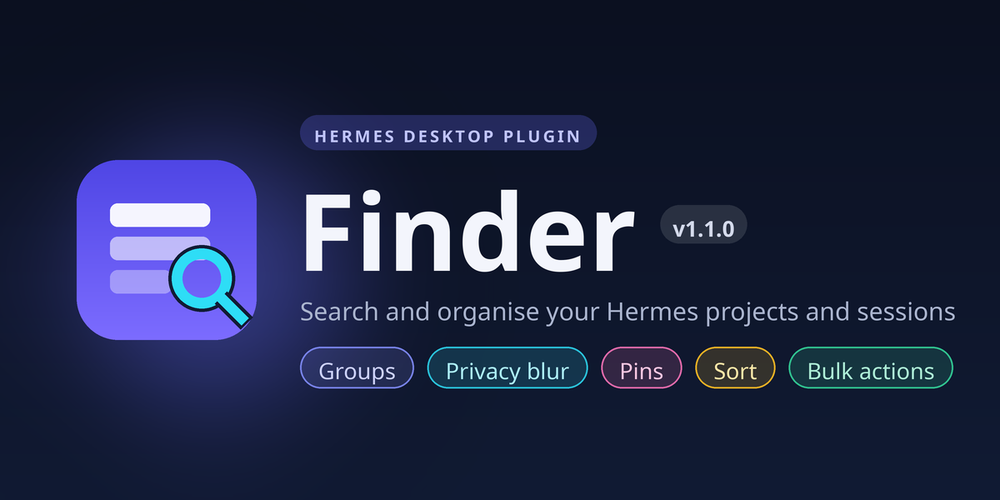

<h1 align="center">Finder for Hermes Desktop</h1>

<p align="center">
  Find any project or session in seconds, right from the sidebar.
</p>

<p align="center">
  
  <a href="https://hermes-agent.nousresearch.com/docs/plugins/finder"></a>
  
  
  
  
</p>

---

## 🔎 What it is

Hermes' built-in sidebar search looks at a session's title, preview, folder and
git branch, but it never looks at the **project** a session belongs to, and
there is no way to search projects by name at all. Finder fixes that.

It adds a **Finder** tab to the sidebar strip (right next to Sessions and Bots)
with one search box that spans your whole workspace. Type a project name and you
instantly get the project and every conversation inside it.

## ✨ Highlights

- 🗂️ **Search projects by name** (the thing core search cannot do), plus the
  usual session fields: title, preview, folder, git branch, repo, source, model.
- 🧭 **Three focused views** so you always see the right shape of your work.
- 🖱️ **Right-click menus** for the actions you actually reach for: new session,
  search and move a session to another project, rename, recolour, reorder, archive,
  delete, copy id.
- 📊 **Token and cost stats** per session and per project, with a running total.
- 🫀 **Live context meter** for the chat you have open, so you can see how full
  the window is without leaving what you are doing.
- 🎨 **Colours and custom order** that persist, plus drag to reorder projects.
- ♻️ **Always fresh.** Updates live when projects or sessions change.
- 🆕 **Create in place.** Header buttons start a New session or a New project without leaving Finder. Group-created projects use the current workspace folder or the folder picker in the popup.
- 📁 **Groups.** Every project lives in a group (default **General projects**); make your own groups and move projects between them.
- 🫥 **Privacy / blur.** Hide sensitive names when screen-sharing by blurring titles **per project, per group, or all at once** (hover to reveal). Blur-all toggles from the header (eye) or Cmd/Ctrl+Alt+P; per-project and per-group blur live in the right-click menus.
- 📌 **Pin** the projects and sessions you use most to the top.
- ↕️ **Sort** by last active, name, token use, cost, or your own custom order.
- ☑️ **Multi-select** sessions for bulk archive, delete, colour, or move to a project.

## 🧭 The tabs

| Tab | What you get |
| --- | --- |
| **All** | Every project grouped (including the project-less bucket), expandable to its sessions. |
| **Groups** | Only your groups, each expandable to the projects inside it. |
| **Projects** | Only real projects, each one expandable to the sessions inside it. |
| **Sessions** | A flat list of every session, with its project shown as a tag. |

## 🖱️ Right-click menus

**On a project**
- ➕ Create session here (uses the project folder; a name-only project adopts the current workspace folder)
- 📋 Copy folder path
- 📌 Pin / unpin
- 🫥 Blur name (privacy)
- 📁 Move to group (or create a new group)
- ✏️ Rename
- 🎨 Colour (presets, custom, or clear)
- ⬆️ Move to top / ⬇️ Move to bottom (or drag the handle, in custom-order mode)
- 🗑️ Delete project (your sessions are kept, they only lose the grouping)

**On a group**
- 🆕 New project here (created in this group)
- ➕ New group
- ✏️ Rename group
- 🫥 Blur group (privacy)
- 🎨 Group colour
- 🗑️ Delete group (its projects move back to General projects)

**On empty space**
- 💬 New session
- 🆕 New project
- ➕ New group
- 🫥 Blur all / Unblur all

A **New group** icon also sits in the header toolbar next to New project.

**On a session**
- 💬 Open, in a new tab, or in a new window
- 📁 Search projects and move the session to another project
- 📋 Copy session id
- 📌 Pin / unpin
- 🎨 Tag colour
- 📦 Archive
- 🗑️ Delete (uses Hermes' revision-fenced session API)

## ⬇️ Install

### From the Hermes plugin catalog

Finder is listed in the [Hermes Marketplace](https://hermes-agent.nousresearch.com/docs/plugins/finder), so the one-liner works:

```bash
hermes plugins install finder
```

### Manually, right now

Copy the plugin file into your desktop plugins folder:

```bash
mkdir -p "$HERMES_HOME/desktop-plugins/finder"
cp desktop/plugin.js "$HERMES_HOME/desktop-plugins/finder/plugin.js"
```

Then open the Command Palette (Cmd/Ctrl + K), run **Reload desktop plugins**,
and the **Finder** tab appears next to Sessions.

## ⌨️ Opening it

- Click the **Finder** tab in the sidebar.
- Press **Cmd/Ctrl + Alt + F**.
- Command Palette: **Find projects & sessions**.

Tip: hold Cmd/Ctrl while clicking a session to open it in a new tab, or Shift to
open it in a new window.

## 🔒 Privacy and safety

- Desktop only. It uses the public `@hermes/plugin-sdk` surface and nothing
  else: no agent tools, no hooks, no middleware, no environment variables.
- No network calls, no telemetry. Everything it shows comes from your own
  gateway over its normal RPCs.
- Your custom colours, project order and preferences are stored locally in the
  plugin's own storage.
- Destructive actions ask for confirmation. Deleting a session is refused by
  Hermes while that chat is live, and Finder tells you instead of failing
  quietly.

## 🧩 Requirements

Hermes Desktop version 0.22 or newer.

## 🛠️ Project layout

```
hermes-finder/
  plugin.yaml        catalog manifest
  desktop/
    plugin.js        the plugin (single ESM file, no build step)
  assets/
    icon.svg         icon shown on the catalog card
  README.md
  LICENSE
```

The plugin is a single uncompiled ES module. Edit `desktop/plugin.js`, save, and
run **Reload desktop plugins** to see changes live.

## 🗓️ Changelog

### v1.1.0
- 📁 **Groups.** Organise projects into collapsible groups (default **General projects**); add, rename, recolour and delete groups, and move projects between them. Create a folder-backed project straight into a group from its right-click menu, then create a session from the project menu.
- 🫥 **Privacy / blur.** Blur titles **per project, per group, or all at once** (hover to reveal). Blur-all from the header eye or Cmd/Ctrl+Alt+P.
- 📌 **Pin** projects and sessions to the top.
- ↕️ **Sort toggle.** Last active, name, token use, cost, or your own custom order.
- ☑️ **Multi-select** sessions for bulk archive, delete, colour, or move to a project.
- 🔧 **Compatible session deletion.** Single and bulk deletion use Hermes' revision-fenced Desktop API, including backends that do not expose the legacy `session.delete` RPC.
- 🐛 Fixed blur having no visual effect (the plugin now ships its own blur style instead of relying on a Tailwind class the app does not compile).

### v1.0.0
- 🔎 Search that includes **project names** (which core search cannot), plus session title, preview, folder, git branch, source and model.
- 🧭 Three tabs: All / Projects / Sessions.
- 🖱️ Right-click actions: new session, copy folder path, rename, colour, reorder and delete (projects); open / new tab / new window, copy id, tag colour, archive and delete (sessions).
- 🆕 New session and New project from the header.
- 📊 Token and cost stats, plus a live context meter for the open chat.

## 📄 License

MIT. See [LICENSE](LICENSE).
